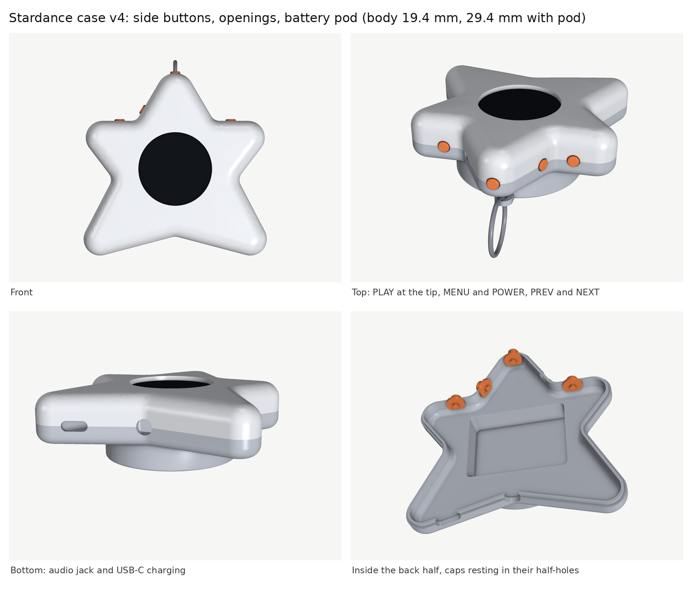
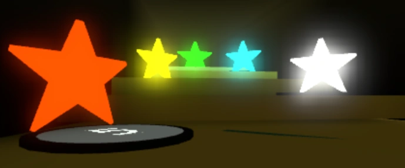
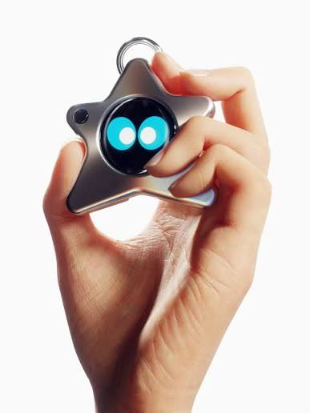
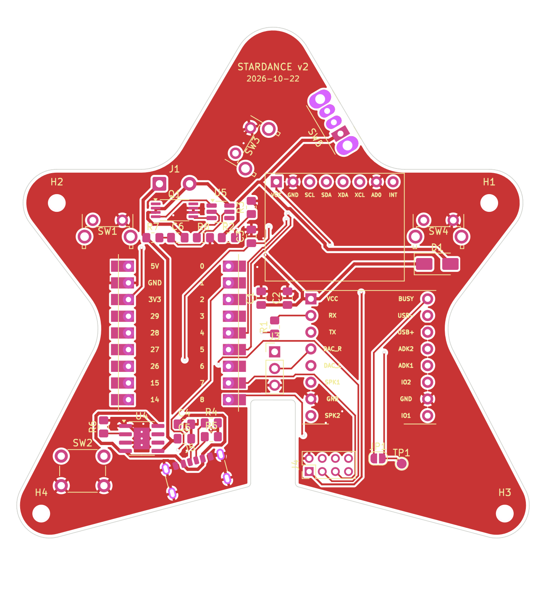
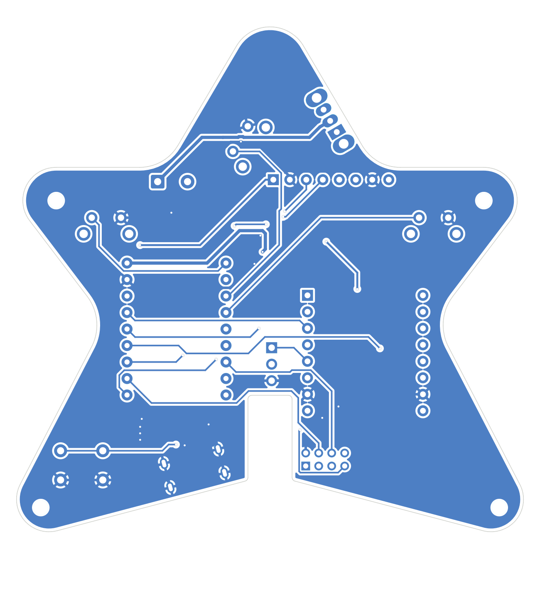
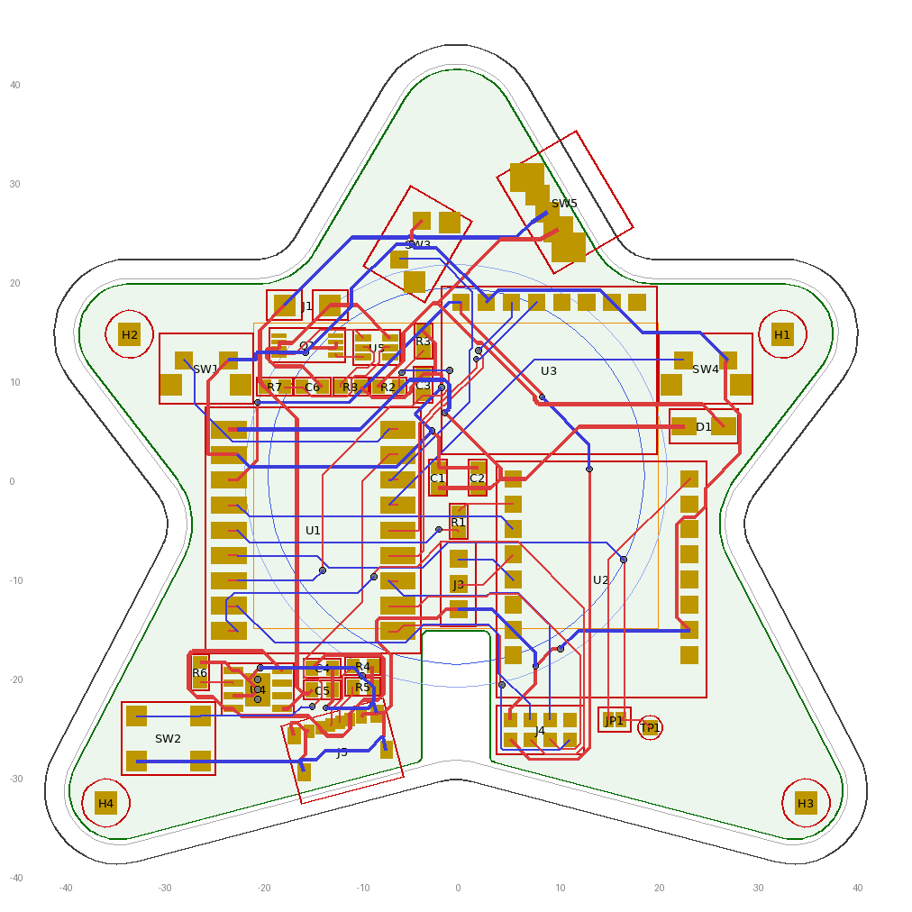
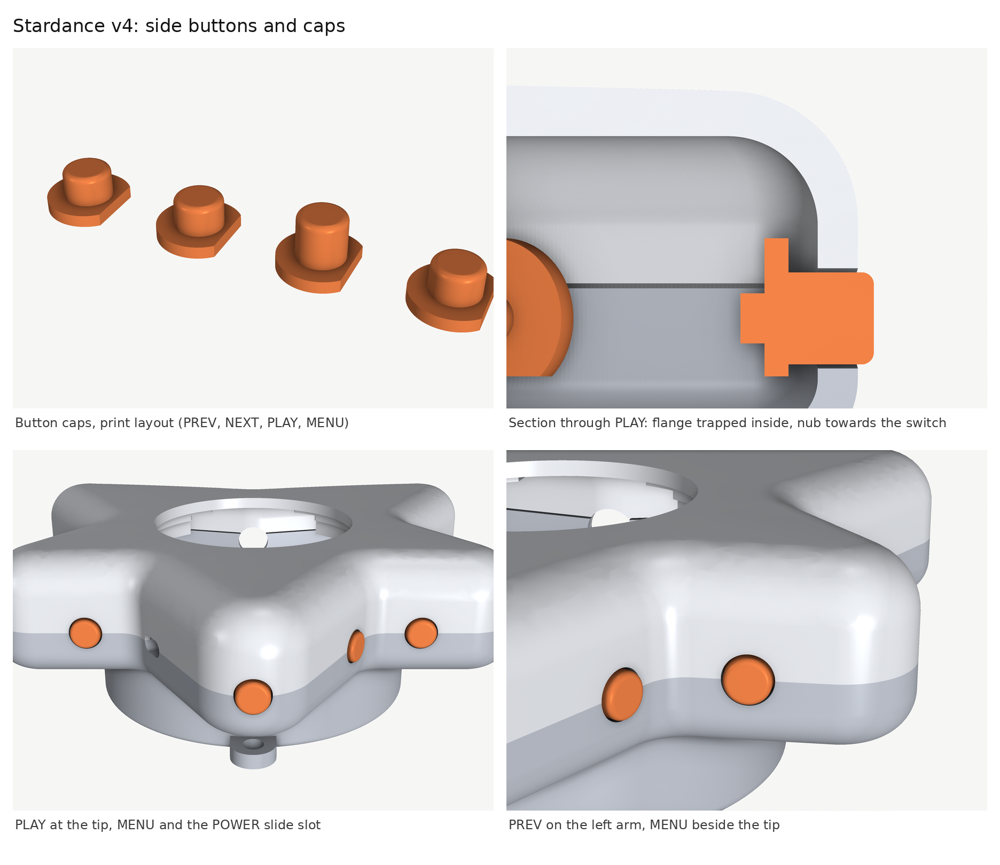
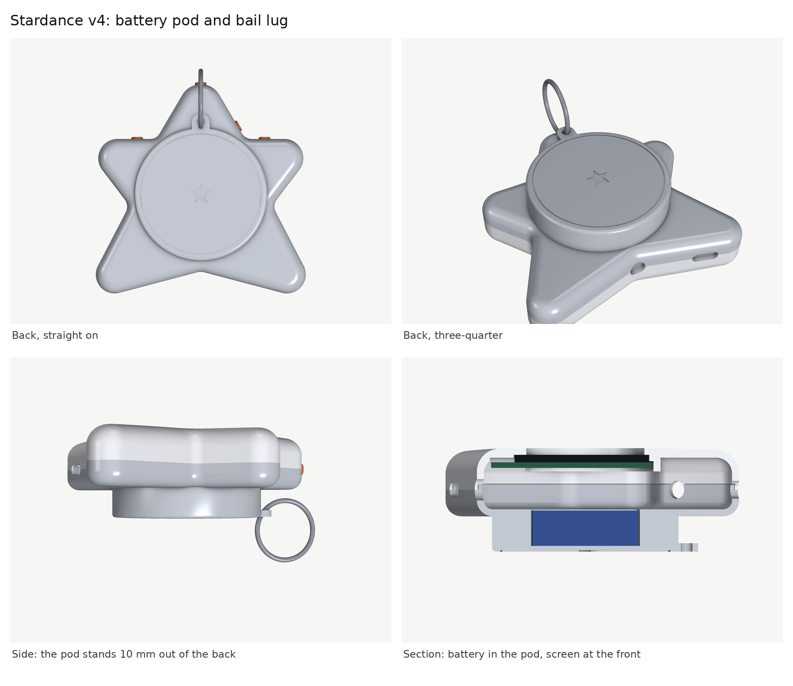

# MP3 Player + Tamagotchi Companion
A MP3 Player that lives under a star-shaped casing and displays a spinning album of the track playing! whilst also a Tamagotchi pet that lives in a round screen and reacts to button interactions, tilt, or even when you shake it.

## Why I built it?
Music is everything to me, it helps me focus and soothes my mind, however my school confiscated our phones making it hard for me to focus in school. Therefore i took it upon myself to create and design my very own mp3 player. Inspired by Lil guy from starboy, I then created my own version of a Tamagotchi pet that uses the faces of bees in a roblox game called Bee Swarm Simulator as the Tamagotchi pet. 




## Inspired by

- **Bee Swarm Simulator (Gifted bees).** The pet's faces are the bees from this Roblox game, and the gifted star is where the star shape comes from.
- **The Lil Guy from Starboy.** A small star-shaped companion you hold in your hand, which is what I wanted to build for real.

| Bee Swarm Simulator, gifted stars | Starboy Lil Guy |
|---|---|
|  |  |

Both images are third-party material, used here only to show the inspiration. They belong to their respective owners.

## Features
- Plays MP3s from a microSD card, organised as playlists (one folder per album)
- Album cover rendered as a spinning disc, full screen, with spin-up and spin-down easing
- Playlist and track chooser over a blurred backdrop of the album art
- Animated pet with idle clips, interactive clips and a "face on a ball" view that follows the tilt of the device
- Shake it and the pet gets dizzy
- A dancing penguin mode (press PLAY in the pet view)
- Autoplay: the next track starts by itself when one ends
- 3.5 mm headphone output
- USB-C charging for a 1200 mAh LiPo (on the PCB design)

### The pet

| Blink | Wink | Tilt follow | Shake to dizzy |
|---|---|---|---|
|  |  |  |  |

## Hardware

| Part | Notes |
|---|---|
| MCU | Waveshare RP2040-Zero |
| Display | GC9A01 1.28" round TFT, 240x240, SPI |
| Audio | DFPlayer Mini (clone) with microSD slot |
| Motion | MPU6050 (GY-521) accelerometer and gyro |
| Output | PJ-307 3.5 mm TRS jack |
| Input | 4 tactile buttons |
| Power | 3.7 V 1200 mAh LiPo (40x30x10 mm), on-board TP4056 charger, DW01A + FS8205A protection, SS14 into VSYS, USB-C |

Parts list: [BOM.csv](BOM.csv). Pricing notes and open questions: [docs/BOM_NOTES.md](docs/BOM_NOTES.md).

The priced lines add up to $59.20 for one device, under the $120 cap. Four lines are unpriced (the LiPo, PCB shipping, case filament, and order shipping and import duties), so the cap check is approximate. Several priced lines are substitutes or upper bounds, which BOM_NOTES.md lists.

### Pinout

| Signal | RP2040-Zero pin |
|---|---|
| Display SCK (labelled SCL on the module) | GP14 |
| Display MOSI (labelled SDA on the module) | GP15 |
| Display CS | GP6 |
| Display DC | GP7 |
| Display RST | GP8 |
| DFPlayer RX (via 1k resistor) | GP28 (MCU TX) |
| DFPlayer TX | GP29 (MCU RX) |
| DFPlayer BUSY (via 10k resistor, used for autoplay) | GP27 |
| MPU6050 SDA | GP4 |
| MPU6050 SCL | GP5 |
| Button PREV | GP0 |
| Button PLAY | GP1 |
| Button NEXT | GP2 |
| Button MENU | GP3 |
| Battery sense (ADC, through a 100k/100k divider) | GP26 |
| Battery in | VSYS (not 3V3) |

The display module borrows I2C names for its SPI pins, so SCL is the clock and SDA is the data line. Buttons are wired to ground and use `INPUT_PULLUP`, so they read low when pressed. GP9 to GP13 are not reachable on this board and are not used.

On the PCB design the DFPlayer VCC is on VSYS. The old breadboard used the 3.3 V rail. The full wiring reference for both is in [wiring.md](wiring.md).

## Hardware files

Only the finished design files are kept in the repo:

- `PCB/stardance_pcb.kicad_pcb` is the carrier board. Open it directly in the KiCad PCB editor.
- `CAD/` has case v4 as STEP files: `stardance_case_v4.step` (the whole case), `stardance_v4_front_shell.step` and `stardance_v4_back_shell.step`. Export STL from these for printing.

Previews of both are in "PCB and case" below. The generator scripts, schematics and older revisions are not included.

## Repository layout

```
Stardance/          the firmware sketch (Stardance.ino and all .cpp/.h files, flat)
tools/
  Spinning Disc/    album art and track name generators
  Pet_Pipeline/     pet animation generator and previewer
  UI_Fonts/         chooser font generator and the font files
  previews/         pet preview gifs and contact sheets
docs/               BOM notes, merge plan, TFT_eSPI setup example, shipping checklist, images/ for the README
PCB/                carrier board (.kicad_pcb)
CAD/                case v4 STEP files
Archive/            old code, kept for reference only
BOM.csv             bill of materials
wiring.md           wiring reference (breadboard and PCB)
```

## Building the firmware

Tested with arduino-pico 6.3.1.

1. Install the Arduino IDE and the [arduino-pico](https://github.com/earlephilhower/arduino-pico) core by Earle Philhower (6.3.1).
2. Board: `Waveshare RP2040 Zero`. Flash Size: `2MB (no FS)`.
3. Install the libraries:
   - `TFT_eSPI` 2.5.43
   - `DFRobotDFPlayerMini` 1.0.6
4. Edit `User_Setup.h` in `Documents/Arduino/libraries/TFT_eSPI`. [docs/User_Setup.example.h](docs/User_Setup.example.h) is a starting point. It is a reconstruction from the project notes, not a copy of the working file, and it leaves SPI_FREQUENCY open. The settings that matter:
   ```c
   #define GC9A01_DRIVER
   #define TFT_SPI_PORT 1
   #define TFT_SCLK 14
   #define TFT_MOSI 15
   #define TFT_CS   6
   #define TFT_DC   7
   #define TFT_RST  8
   ```
5. Open `Stardance/Stardance.ino` and upload.

If a change to `User_Setup.h` does not seem to take effect, delete the cached build in `AppData\Local\arduino\sketches\` and compile again.

Python is only needed to regenerate the album, track, pet and font data: `pip install pillow numpy imageio-ffmpeg` (and `fonttools brotli` for the fonts).

## Preparing the SD card

The DFPlayer only understands exact names:

```
01/001.mp3
01/002.mp3
02/001.mp3
...
```

Folders `01` to `99`, files `001.mp3` to `255.mp3`, no extra text in either name. Each folder is one playlist. The firmware currently knows seven albums, folders `01` to `07`. The music itself is not in this repo.

## Adding an album

Run the generators from the folder that holds their json, with `--out` pointing at the `Stardance` sketch folder.

1. Add the cover image and an entry in `albums.json`, then run
   `python build_albums.py --manifest albums.json --out <sketch>`
2. Add a row for the new folder to `PLAYLIST_ART[]` in `playlist_art.cpp`
3. Add the folder to `tracks.json`, then run
   `python build_tracks.py --manifest tracks.json --out <sketch>`
   (or add `--scan <SD card drive>` to read titles off the card)

If you skip step 2 the album never shows up in the chooser.

## Controls

Each view owns PREV, PLAY and NEXT. In the pet view the music is not touched.

| Button | Disc view | Pet view |
|---|---|---|
| PREV | previous track | pet winks |
| PLAY | play/pause | starts or stops the penguin dance |
| NEXT | next track | affection wink |
| MENU (short) | open the playlist chooser | open the playlist chooser |
| MENU (hold) | switch to pet view | switch to disc view |

In the chooser, PREV and NEXT turn the list, PLAY opens a playlist or plays a track, and MENU goes back. When a track ends, the next one in the playlist starts by itself (autoplay).

The device boots into the pet view.

## PCB and case

The carrier PCB (version 2) is a 2-layer, 1.2 mm board that holds the RP2040-Zero, DFPlayer, MPU6050, buttons, jack and the charging circuit, with the battery underneath. The case is 3D printed and closes with four M2 screws into heat-set inserts. The board is `PCB/stardance_pcb.kicad_pcb` and the case v4 files are in `CAD/` (see "Hardware files").

### PCB

| Front | Back |
|---|---|
|  |  |



### Case





The remaining steps are tracked in [docs/SHIPPING_CHECKLIST.md](docs/SHIPPING_CHECKLIST.md).

### Known limitations / not done yet

- The merged firmware has not been flash-tested as one build on the final PCB.
- PCB v2 has not been fabricated yet.
- The case has not been updated for PCB v2 (button and USB-C positions, M2 inserts).
- There are no volume buttons. The default volume is set to 15 of 30.
- There is no on-screen battery indicator. The battery is read on GP26 and logged to Serial.
- Debug prints are off by default.
- The left/right tilt sign of the pet's face is unconfirmed on hardware (up/down is confirmed).
- `User_Setup.h` for TFT_eSPI has to be edited by hand (see docs/User_Setup.example.h).
- The album covers in `tools/Spinning Disc/covers/` and the penguin gif are third-party artwork. They are placeholders. Replace them with your own or properly licensed art before redistributing this repo. The music is not in the repo.
- The BOM is approximate: four lines are unpriced and some prices are substitutes (see docs/BOM_NOTES.md).

## Credits

- [TFT_eSPI](https://github.com/Bodmer/TFT_eSPI) by Bodmer
- [DFRobotDFPlayerMini](https://github.com/DFRobot/DFRobotDFPlayerMini) by DFRobot
- [arduino-pico](https://github.com/earlephilhower/arduino-pico) by Earle Philhower
- Lora and DM Sans fonts, SIL Open Font License (license texts in `tools/UI_Fonts/fonts/`: [OFL-Lora.txt](tools/UI_Fonts/fonts/OFL-Lora.txt), [OFL-DMSans.txt](tools/UI_Fonts/fonts/OFL-DMSans.txt))
- The pet animations are my own clips. The dancing penguin is a Block Tales fan gif, credited here as that and to be replaced before redistribution.
- Album covers: third-party artwork, placeholders (see Known limitations).
